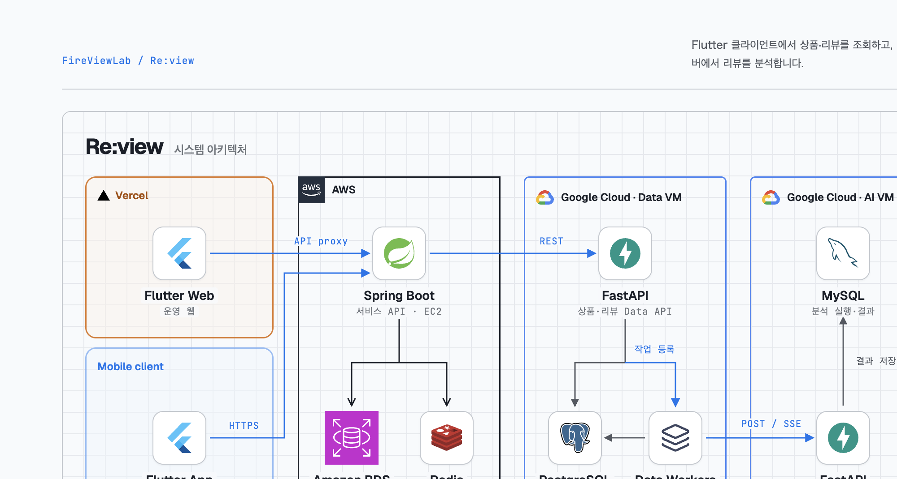

  

<h1 align="center">Re:view</h1>

  <strong>별점 너머의 리뷰를 보고, 여러 쇼핑몰의 상품을 비교합니다.</strong> 
  상품 검색부터 리뷰 신뢰도 확인, 판매처별 가격 비교까지 한곳에서 이어집니다.

  <a href="https://re-view.kr">서비스 열기</a> ·
  <a href="#주요-기능">주요 기능</a> ·
  <a href="#시스템-아키텍처">시스템 아키텍처</a> ·
  <a href="#저장소">저장소</a>

## 서비스 소개

여러 쇼핑몰을 오가며 가격과 후기를 확인해도, 별점만으로는 어떤 리뷰를 참고할지 알기 어렵습니다. Re:view는 수집한 상품과 리뷰를 한곳에 모으고, <strong>RTI(Re:view Trust Index)</strong>로 리뷰에서 발견한 신뢰도 신호를 보여줍니다. RTI는 구매 판단을 돕는 참고 지표이며, 개별 리뷰의 진위를 확정하지 않습니다. 아직 분석하지 않은 상품은 0점 대신 **분석 전**으로 표시합니다.

## 화면

| 홈 | 상품 상세 | 상품 문맥 채팅 |
| :---: | :---: | :---: |
|  |  |  |

2026년 10월 웹 검증 화면입니다. 현재 화면과 일부 문구·배치가 다를 수 있습니다.

## 주요 기능

| 기능 | 할 수 있는 일 |
| --- | --- |
| 상품 탐색·비교 | 여러 쇼핑몰의 상품을 검색하고 판매처별 상품과 가격을 비교합니다. |
| 리뷰 신뢰도 | 상품 상세에서 RTI 요약과 리뷰별 분석 근거를 확인합니다. |
| 찜·장바구니 | 관심 상품을 저장하고 비교할 후보를 모아둡니다. |
| 상품 문맥 채팅 | 보고 있는 상품의 정보와 리뷰를 바탕으로 추가 질문을 할 수 있습니다. |

## 시스템 아키텍처

<picture>
  <source media="(prefers-color-scheme: dark)" srcset="assets/architecture-dark.png">
  
</picture>

1. **클라이언트 → Spring API:** 운영 웹은 Vercel 프록시로 접속하며, 모바일 앱은 API를 HTTPS로 직접 호출합니다. Spring은 인증, 사용자 기능, 상품 화면 데이터 조합을 담당합니다.
2. **Spring API → Data API:** Spring은 상품·리뷰·분석 결과를 Data API에서 조회합니다. Data 서버는 수집이 필요한 경우 작업을 등록하고, 이용할 수 있는 기존 데이터가 있으면 먼저 반환합니다.
3. **Data 워커 → AI 분석 API:** 수집 워커가 상품·리뷰를 갱신하고, 분석 워커가 리뷰를 AI 서버에 전달합니다. AI 서버는 분석 결과를 저장하고 SSE로 반환합니다. Data 서버가 이를 저장하므로 클라이언트는 AI 서버를 직접 호출하지 않습니다.

구성도: <a href="https://github.com/wp230/stack-diagram">stack-diagram</a>.

## 기술 스택

| 영역 | 기술 | 담당 |
| --- | --- | --- |
| 클라이언트 | Flutter, Dart, Riverpod, GoRouter | 웹·Android·iOS UI, 상태 관리와 라우팅 |
| 서비스 API | Spring Boot, Spring Security, JPA, PostgreSQL, Redis | 상품 화면 데이터 조합, OAuth2·세션, 찜·장바구니·상품 채팅 |
| 상품·리뷰 데이터 | Python, FastAPI, Playwright, PostgreSQL, Docker Compose | 상품·리뷰 수집, 작업 스케줄링, 데이터·분석 결과 제공 |
| 리뷰 분석 | Python, FastAPI, KoELECTRA, PyTorch, MySQL | 리뷰 신뢰도 분석과 분석 결과 저장·스트리밍 |
| 배포 | Vercel, AWS EC2·RDS, Google Cloud Compute Engine, GitHub Actions | 웹 배포, 서비스별 실행 환경과 CI/CD |

## 저장소

저장소별 README와 문서에서 로컬 실행 방법과 연동 계약을 확인할 수 있습니다.

| 저장소 | 내용 |
| --- | --- |
| [`review-frontend`](https://github.com/FireViewLab/review-frontend) | Flutter 웹·모바일 앱과 [빠른 시작](https://github.com/FireViewLab/review-frontend#빠른-시작) |
| [`review-backend`](https://github.com/FireViewLab/review-backend) | Spring Boot 서비스 API와 [아키텍처 문서](https://github.com/FireViewLab/review-backend/blob/main/docs/architecture.md) |
| [`review-data`](https://github.com/FireViewLab/review-data) | 쇼핑몰 상품·리뷰 수집, 카탈로그 API와 분석 워커 |
| [`review-ai-db`](https://github.com/FireViewLab/review-ai-db) | 리뷰 분석 API, [SSE 연동 계약](https://github.com/FireViewLab/review-ai-db/blob/main/docs/data-analysis-stream.md)과 결과 저장 |

## 팀

| 이름 | 담당 |
| --- | --- |
| 김동환 | 팀 리드, 서비스 전반 및 인프라 |
| 정빈 | Flutter 웹·앱 UI와 상태 관리, 일부 쇼핑몰 데이터 수집 |
| 남정현 | Spring Boot 서비스 API, 일부 쇼핑몰 데이터 수집 |
| 김하연 | 리뷰 분석 모델·API, 일부 쇼핑몰 데이터 수집 |

## 시연·발표 자료

아래 자료는 1학기 버전으로, 위의 현재 서비스 구성과는 다를 수 있습니다.

- [서비스 시연 영상](https://youtu.be/rIGmGRdqm48)
- [1학기 발표 자료 (PPTX)](FireView%20%ED%94%84%EB%A1%9C%EC%A0%9D%ED%8A%B8%201%ED%95%99%EA%B8%B0%20%EB%B0%9C%ED%91%9C.pptx)
